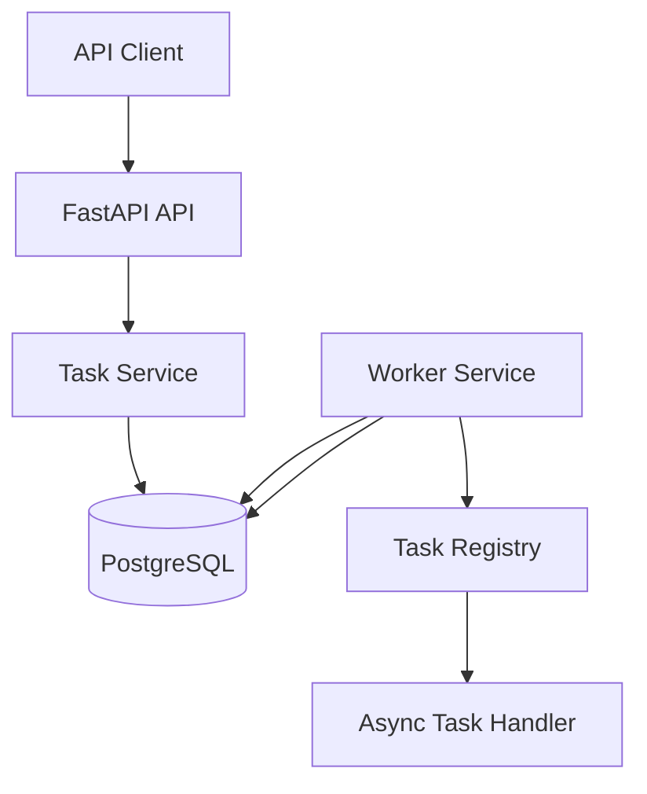

# Aegis — System Design

**Status:** Initial design draft  
**Version:** 0.1.0  
**Implementation status:** Core API and worker functionality implemented

## 1. Overview

Aegis is a lightweight, asynchronous background task processing system built with Python, FastAPI, and PostgreSQL.

It provides an API for submitting tasks, persists them for processing, and uses workers to execute registered handlers. It is designed to support retries, delayed execution, idempotent submissions, cancellation, and recovery from interrupted worker execution.

The initial implementation uses PostgreSQL for task persistence and worker coordination. A separate message broker is not currently part of the architecture.

### Goals

- Accept and persist background tasks through an HTTP API.
- Execute registered task handlers asynchronously.
- Track task status, attempts, results, and errors.
- Retry failed tasks with exponential backoff.
- Support scheduled execution and queue separation.
- Prevent duplicate task creation for repeated idempotent requests.
- Coordinate workers using database locking and leases.
- Recover tasks left running after a worker interruption.
- Provide a testable foundation for future packaging as a Python library.

### Non-goals for the initial version

- A web dashboard.
- A managed, multi-tenant hosted service.
- A separate Redis or RabbitMQ broker.
- A guarantee of exactly-once task execution.
- A claim of production-scale throughput before load testing.

## 2. Requirements

### Functional requirements

| Requirement | Intended behavior |
|---|---|
| Task submission | Accept a task name, payload, queue, and execution options |
| Task persistence | Store tasks in PostgreSQL |
| Task retrieval | Retrieve a task by ID and list tasks |
| Handler dispatch | Execute a registered handler for the task name |
| Scheduling | Make tasks eligible for execution at their scheduled time |
| Retry | Retry eligible failures up to the configured attempt limit |
| Idempotency | Return the existing task for an identical request using the same key |
| Cancellation | Allow cancellation to be represented and handled by the worker |
| Lease renewal | Extend ownership while a worker is executing a task |
| Recovery | Find expired worker leases and reschedule or fail affected tasks |

### Non-functional requirements

- **Correctness:** Task state transitions must be validated and persisted consistently.
- **Concurrency safety:** Multiple workers must not claim the same available task simultaneously.
- **Recoverability:** Interrupted work must be discoverable through persisted state.
- **Observability:** Failures and worker activity should be diagnosable through logs and metrics.
- **Maintainability:** Task execution, API handling, persistence, and handler registration should remain separate concerns.

Performance targets have not yet been established. They will be defined after baseline load testing.

## 3. Architecture

### Components

- **FastAPI application:** Exposes task submission and retrieval endpoints.
- **Task service:** Handles task creation, persistence, and idempotency logic.
- **PostgreSQL:** Stores task state, execution attempts, and idempotency records.
- **Worker service:** Claims tasks, manages execution leases, runs handlers, and records outcomes.
- **Task registry:** Maps task names to registered asynchronous handlers.
- **Handler implementations:** Contain the application-specific work, such as `add_numbers`.

### Architecture diagram



PostgreSQL is both the durable task store and the coordination mechanism between workers. The worker polls for eligible tasks and uses database transactions and row-level locking to coordinate claims.

The diagram describes the logical architecture. Deployment topology, process supervision, and network boundaries still need to be documented and verified.

## 4. Task lifecycle

The task model includes these statuses:

- `PENDING`
- `RUNNING`
- `RETRYING`
- `SUCCEEDED`
- `FAILED`
- `CANCELLED`

A typical successful lifecycle is:

```text
PENDING → RUNNING → SUCCEEDED
```

A retryable failure follows this general path:

```text
PENDING → RUNNING → RETRYING → RUNNING → SUCCEEDED
```

A task that exhausts its allowed attempts transitions to `FAILED`.

Cancellation may result in `CANCELLED`. The worker also checks cancellation requests during execution.

These transitions describe the intended lifecycle. The exact allowed transitions, especially around cancellation races and expired leases, must be verified against the service implementation and integration tests.

## 5. Data model

### Task

Represents a submitted unit of work.

Key fields include:

- `id`: UUID primary key.
- `name`: Registered handler name.
- `queue_name`: Queue the task belongs to.
- `payload`: JSON task input.
- `status`: Current lifecycle status.
- `scheduled_at`: Earliest eligible execution time.
- `attempts`: Number of attempts started.
- `max_attempts`: Maximum permitted attempts.
- `locked_by`: Current worker identifier.
- `locked_until`: Lease expiration timestamp.
- `lease_token`: Token used to validate worker ownership.
- `result`: Persisted successful result.
- `last_error`: Most recent recorded failure.
- `cancel_requested`: Indicates a cancellation request.
- `started_at`, `completed_at`: Lifecycle timestamps.

Creation and update timestamps are inherited from the shared model base.

### TaskAttempt

Records an individual execution attempt, including:

- Associated task and attempt number.
- Worker identifier.
- Attempt status.
- Start and finish timestamps.
- Error information.
- Execution result.

A uniqueness constraint on `(task_id, attempt_number)` prevents duplicate attempt records for the same numbered attempt.

### IdempotencyRecord

Associates an idempotency key with a task and a request hash.

Key fields include:

- `scope`: Namespace for the idempotency key.
- `key`: Client-supplied idempotency key.
- `request_hash`: Fingerprint of the submitted request.
- `task_id`: Associated task.
- `expires_at`: Optional expiry timestamp.

The model has uniqueness constraints for `(scope, key)` and `task_id`.

### Indexes and constraints

The current model includes indexes intended to support:

- Queue, status, and scheduled-time filtering.
- Finding running tasks with expired leases.
- Creation-time queries.

Check constraints validate attempt counts and maximum attempts. Actual query plans and index effectiveness have not yet been benchmarked.

## 6. API surface

The current API includes:

| Method | Endpoint | Purpose |
|---|---|---|
| `POST` | `/api/v1/tasks/create` | Submit a task |
| `GET` | `/api/v1/tasks/{id}` | Retrieve a task |
| `GET` | `/api/v1/tasks` | List tasks |

Task creation accepts fields such as `name`, `queue_name`, `payload`, `scheduled_at`, and `max_attempts`.

The creation endpoint accepts the `Idempotency-Key` HTTP header. Repeated submissions using the same key and request should return the existing task; reusing a key with a different request should produce a conflict.

The documented route list does not currently establish a dedicated public endpoint for cancellation or worker administration. These capabilities must be checked against the current router before being advertised as public API features.

A future API reference should define complete request schemas, response schemas, validation behavior, pagination, error codes, and authentication requirements.

## 7. Task claiming and concurrency

The worker selects eligible tasks that:

- Are pending or retrying.
- Have reached their scheduled execution time.
- Have not exhausted their attempt limit.
- Belong to the queue being processed.

The claim operation uses a transaction and PostgreSQL `FOR UPDATE SKIP LOCKED` to coordinate competing workers.

When a task is claimed, the worker records its identity, sets a lease expiration, assigns a lease token, increments the attempt count, and creates an attempt record.

This approach is intended to let multiple workers claim different tasks without waiting on rows already locked by other workers.

It does not by itself guarantee exactly-once execution. A worker can perform an external side effect and crash before recording success. Handlers that perform non-idempotent external operations may therefore need their own deduplication or transactional safeguards.

## 8. Leases, heartbeats, and recovery

A lease represents a worker's temporary ownership of a running task.

The worker periodically renews its lease while executing the handler. Operations that change task state validate the lease token and check that the lease remains valid.

If a lease expires, recovery logic can identify the running task, record the interrupted attempt as failed, and either schedule a retry or mark the task as failed when attempts are exhausted.

### Important failure boundary

Lease expiration does not prove the original worker has stopped executing. It may be paused, disconnected, or still performing an external side effect.

The implementation must prevent a stale worker from overwriting newer task state. External side effects may require idempotency keys or fencing mechanisms beyond database lease checks.

Heartbeat failure, database unavailability, recovery races, and stale-worker behavior remain important areas for end-to-end verification.

## 9. Retry policy

Failed tasks can be retried up to `max_attempts`.

The worker uses exponential backoff, currently based on:

```python
min(2 ** task.attempts, 300)
```

This caps the calculated delay at 300 seconds.

The retry policy should be reviewed for its exact attempt numbering, scheduling timestamp updates, exception classification, and interaction with worker crashes. Jitter, configurable retry policies, and dead-letter handling have not been established as completed features.

## 10. Idempotency

The idempotency mechanism is designed to make repeated task submissions safe when a client retries an HTTP request after a timeout or uncertain response.

The service computes a request hash and looks up the `(scope, key)` record.

- Same key and same request: return the previously created task.
- Same key and different request: reject the request.
- New key: create a task and its idempotency record.

Database uniqueness constraints provide an additional protection against duplicate records.

The concurrent-request path must be verified carefully. In particular, transaction rollback and recovery after an integrity conflict must be correct, and the supplied scope must be used consistently. Idempotency-record expiry is not a completed feature merely because the schema contains an optional expiry field.

## 11. Failure modes

| Failure | Expected handling | Verification needed |
|---|---|---|
| API process exits before committing | Database transaction should roll back | Confirm with integration tests |
| PostgreSQL becomes unavailable | Operations should fail visibly; no false success response | Verify errors and recovery after reconnection |
| Worker exits while holding a lease | Lease eventually expires and recovery requeues or fails the task | Test with a real worker process |
| Handler raises an exception | Record failure and retry when eligible | Covered at service/test level; verify end to end |
| Handler runs longer than expected | Heartbeat renews lease while the handler remains healthy | Verify with a slow handler |
| Worker loses lease | Stale worker must not overwrite newer task state | Test concurrent recovery and completion |
| Same HTTP request is retried | Return the original task for the same key and request | Verify concurrent requests |
| Same key is reused with different input | Reject the conflicting request | Service-level test exists |
| External side effect succeeds before worker crashes | Side effect may occur again on retry | Handler-specific idempotency may be required |
| All retries are exhausted | Task reaches `FAILED` | Verify status and attempt records |
| Task is scheduled for the future | Worker must not claim it early | Verify with database-backed test |

These are expected behaviors and design requirements, not claims that every failure scenario has already been tested.

## 12. Alternatives considered

### PostgreSQL polling versus a dedicated broker

**Current choice: PostgreSQL-backed coordination.**

Advantages:
- Fewer infrastructure components.
- Task state and worker coordination use the same durable database.
- Transactions and row-level locks support concurrent claims.
- Easier initial development and local setup.

Trade-offs:
- Polling adds database queries even when queues are idle.
- Queue throughput competes with application database workloads.
- High task volumes may increase lock contention and database pressure.
- Broker-specific features are not available automatically.

Redis or RabbitMQ could be evaluated if measured workloads justify the added operational complexity. Any migration would need to preserve task durability, retry semantics, and recovery behavior.

### Why not promise exactly-once execution?

A database transaction cannot atomically cover arbitrary external operations such as sending an email or calling a third-party API. A worker may repeat an operation after a crash.

Aegis therefore aims for durable task tracking and safe worker coordination, with idempotent handling where necessary, rather than claiming universal exactly-once execution.

## 13. Security and operations

Before exposing Aegis beyond a trusted development environment, review:

- Authentication and authorization for task submission and retrieval.
- Tenant and queue isolation where multiple clients are supported.
- Request-size and payload validation limits.
- Secret management and safe logging.
- Database connection pooling and timeouts.
- Health and readiness checks.
- Structured logs and metrics.
- Graceful worker shutdown.
- Database migrations, backup procedures, and restore testing.


## 14. Performance and scalability

No throughput or latency targets are claimed in this initial design.

A benchmark should measure:

- Task submissions per second.
- Task completion throughput.
- API p50, p95, and p99 latency.
- Queue waiting time.
- Failure and retry rates.
- Database CPU, memory, connections, and lock contention.
- Worker CPU and memory use.

Tests should begin with a repeatable baseline, then increase concurrency and task volume to identify the bottleneck.

The first scaling step should be based on measurements, not assumptions. Potential options include tuning database indexes and polling, increasing worker concurrency, separating workloads by queue, or introducing a dedicated broker.

## 15. Open questions

The following decisions need to be resolved or documented as part of the completion process:

1. What throughput and latency targets should the first release support?
2. Which exceptions are retryable, and which should fail immediately?
3. Should retries include jitter and configurable policies?
4. What is the public cancellation API contract?
5. How should idempotency records expire and be cleaned up?
6. What behavior is required during graceful worker shutdown?
7. What authentication and tenant-isolation guarantees are required?
8. What deployment and backup strategy will be supported?
9. What evidence is needed before claiming multi-worker or multi-machine support?

## 16. Current implementation status

This document is an initial design baseline.

The project has implemented core task persistence, asynchronous worker operations, task attempts, retry logic, lease renewal, expired-lease recovery, cancellation handling, handler registration, and idempotency logic. Automated tests have exercised several of these behaviors.

The next completion milestones are:

1. Review the implementation against this document.
2. Close correctness gaps in idempotency and lease-loss handling.
3. Verify API behavior and failure scenarios end to end.
4. Establish performance baselines.
5. Complete production-style deployment and operational documentation.
6. Write a retrospective informed by test and benchmark evidence.
